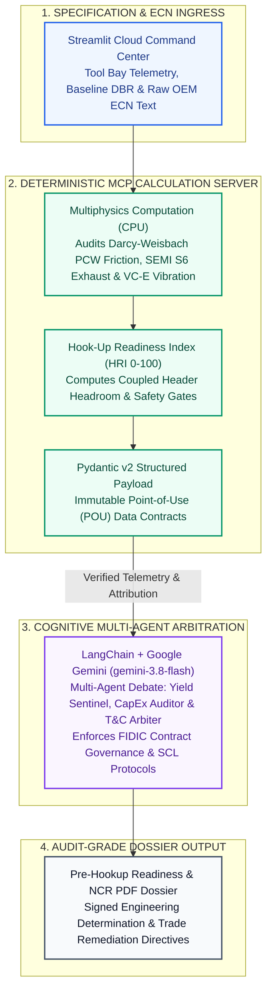

# Autonomous Semiconductor Change Intelligence & Hook-Up Arbiter

> **Dataset & Confidentiality Note:** This application is an independent engineering architecture demonstration validated on representative, anonymized project datasets.

---

### Executive Problem Statement
On &#36;3B–&#36;28B semiconductor fab projects, Phase 3/4 cleanroom fit-out, tool move-in, and testing & commissioning (T&C) face an acute operational bottleneck. Continuous revisions to OEM process tool manuals collide with fixed base-build sub-fab headers and overlapping contractor schedules. Every single day of delay to 'First Wafer' output costs semiconductor owners between &#36;1M and &#36;5M+ in deferred revenue, while manual tracking across spreadsheets fails to catch coupled hydraulic and exhaust shortfalls.

### Operational Value
- **Prevents Cleanroom Tear-Out & Schedule Slip:** Immediately recalculates coupled sub-fab fluid and exhaust physics when an OEM issues a late specification change—flagging lateral pipe or duct upsizing directives before cleanroom welding begins.
- **Protects CapEx Against Inflated Claims:** Runs deterministic schedule concurrency math under SCL Delay Protocols and FIDIC Sub-Clause 8.4 rules to isolate liability across Base-Build MEP, Tool-Install Contractors, and Tool OEMs, certifying only strictly justified Extension of Time (EoT) days.
- **Shields Wafer Yield & Life Safety:** Enforces SEMI S2, SEMI F47, ISO 14644-1, and VC-E/VC-G micro-vibration limits prior to Gas-Turn-On (GTO) clearance.

---

### System Architecture

---

### Technology Stack
- **Runtime & UI:** Python 3.12, Streamlit Community Cloud
- **Orchestration & LLM:** LangChain, Google Gemini (`gemini-3.8-flash`)
- **Deterministic Analytics:** Pandas, Pydantic v2, ReportLab PDF Engine

---

### Author & Architect
**Rohit Kumar, PMP, CEng (India), CEA, FSEr (TÜV)**  
*Mission-Critical Infrastructure & Systems Engineering Specialist | Forensic Project Controls & Contract Governance*  

[LinkedIn](https://linkedin.com) | [Live Application](https://streamlit.app)

---

### Enterprise Advisory & Custom Architecture
Available for technical consulting, custom agentic workflow development, and private enterprise deployments.

- **Connect:** [LinkedIn](https://linkedin.com)
- **Email:** grohit41@gmail.com

---

### Intellectual Property & Licensing
Copyright © 2026 Rohit Kumar. All Rights Reserved.

This repository and its source code are published solely for technical portfolio evaluation and architectural demonstration. Unauthorized copying, redistribution, or commercial deployment is prohibited without prior written consent.
